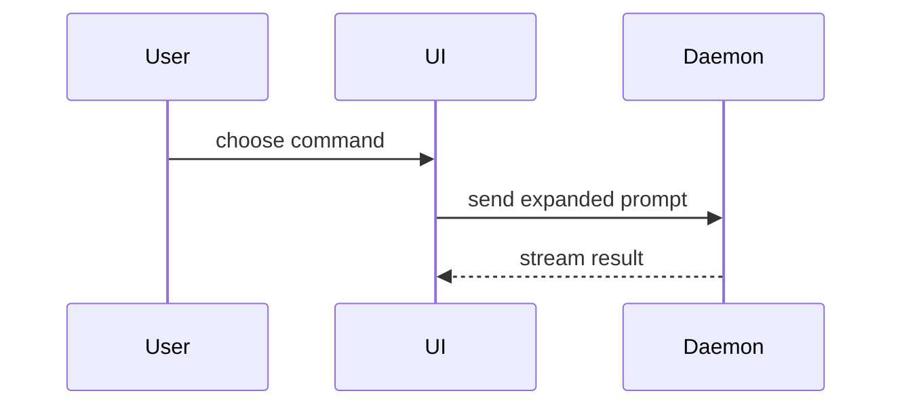

<!-- Matt Pocock's pr Skill (https://github.com/mattpocock/skills, v1.3.1), word for word below the line, with its
CREDITS.md beside it. Copyright (c) 2026 Matt Pocock. MIT License: see LICENSE in the tdd Skill's folder. -->

## In Ants

Below the line is Matt Pocock's pr Skill, word for word: it writes the body. This section opens
the pull requests. Ants runs it without a chat, so where the two differ, this section wins.

Open one pull request per pushed repo, so the user's reviewers get the context of the Run. Your
inputs; paths are relative to the Run workspace:

- `push`: the Push Result, one entry per repo:
  `{repo, remote, branch, base, isNew, commits: [{sha, subject}], pushed, error, compareUrl}`.
  The clone is `repos/<repo>/`.
- `spec` or `proposal`: what the Run built, `tickets/spec.md` or `proposal/proposal.md`.
- `review`: the implementers' review of their commits, if any: a summary, or their Results, each
  with the summary as `output.review`.
- `fixes`: the review of the fixes made after the user sent the changes back, if any.

You run `gh` on the user's own login, and `git log` and `git diff` in the clones. You change
nothing in the repos and push nothing. Each command is its own Bash call. Run `gh` from wherever
you are, `gh pr` always with `--repo`. Run git from inside a clone: first `cd repos/<repo>`,
then a plain `git log …` (the shell stays in the clone); `cd ../..` takes you back to the
workspace root. Anything else is refused: `git -C …`, `git --git-dir=…`, `git -c …`, `--output`,
and `cd … && git …` or any other chained command.

1. **Pick the repos.** Only entries with `pushed: true`. A repo whose `remote` isn't on
   `github.com` gets no pull request from you: open the others first, then answer `stuck`, naming
   each such repo with its `compareUrl` (or its remote and branches when there is none), so the
   user can open it by hand and Continue. When Continued, answer `done` with the pull requests you
   opened. For each github.com repo, read `<owner>/<name>` from the remote and run
   `gh repo view <owner>/<name> --json parent`. If `parent` is null, the pull request goes to
   `<owner>/<name>` from `<branch>` into `<base>`: `<target>` is `<owner>/<name>`, `<head>` is
   `<branch>` and `<target base>` is `<base>`. If it names a parent, the remote is a fork, and the
   pull request goes to the parent: `<target>` is `<parent-owner>/<parent-name>`, `<head>` is
   `<owner>:<branch>` and `<target base>` is the parent's default branch, which
   `gh repo view <parent-owner>/<parent-name> --json defaultBranchRef` gives. Read the JSON `gh`
   prints; don't pass `--jq`. If `gh pr view <head> --repo <target>` already shows an open pull
   request for that head, keep it: don't open a second one.
2. **Write the body** as below, from the spec or proposal, the review and the fixes, and
   `git log` and `git diff` from `<base>`, inside the clone. `GLOSSARY.md` is the clone's. The
   review and the fixes are evidence, and tell you the Merge Danger. You can't take screenshots.
   The title is one short line saying what the change does, in plain words with no backticks:
   claude refuses a command with a backtick in it, and the title goes on the command line.
3. **Open it:** write the body to `pr/<repo>.md` in the Run workspace, then, from the workspace
   root, run `gh pr create --repo <target> --head <head> --base <target base> --title "…"
   --body-file pr/<repo>.md`. Never pass the body inline with `--body`: claude refuses a command
   with a backtick in it, and a body usually has one. If `gh` isn't logged in or is refused, answer
   `stuck` with its message.

Answer `done` with `pullRequests: [{repo, url}]`.

---

Use this template for writing the PR body:

```markdown
## Summary

<diagram, diff-sketch, or tree>

## Evidence

- **Before:** <screenshot/output/failing test run>
  **After:** <screenshot/output/passing test run>

## Merge Danger

**Door:** <one-way or two-way>

<optional: description>

**Blast Radius:** <one-word description>

<optional: potential ramifications of merge>
```

## Sections

Skip all preambles and keep prose brief. Use the user's domain language from `GLOSSARY.md`.

### Summary

Pick the smallest view that makes the key point clear.

- Show logic or an algorithm as pseudocode:

```text
on(save)
  if content is unchanged
    return cached result
  write new content
  return fresh result
```

- Show runtime control flow as a call tree:

```text
submitForm
  createSession
    persistPrompt
    launchAgent
  navigateToSession
```

- Show UI structure as a component tree, including state and module boundaries that matter:

```text
<SessionPage> (apps/example/src/routes/session.tsx)
  useSessionEvents()
  <SessionToolbar>
    <RunSkillButton> (packages/ui)
```

- Show file responsibility or a broad refactor as a shallow file tree:

```text
src/
├── commands/       # parses user actions
├── sessions/       # owns session state
└── transport/      # sends API requests
```

- Show component interaction, control flow, or data flow with Mermaid:



- Use `diff` when the point is what changes and the surrounding shape already exists. Match the diff shape to the topic.

For a component change:

```diff
 <SessionPage>
   useSessionEvents()
   <SessionToolbar>
+    <RunSkillButton />
   <SessionTimeline>
+    <SkillResultCard />
```

For a file-layout change:

```diff
 src/
 ├── commands/
+│   └── show-me.ts       # expands the slash command
 ├── sessions/
-└── transport.ts
+└── transport/
+    ├── client.ts
+    └── stream.ts
```

For a call-tree or call-stack change:

```diff
 submitForm
   createSession
     persistPrompt
+    expandSkillMention
     launchAgent
-  navigateToSession
+  navigateToSession
+    subscribeToEvents
```

For a state or control-flow change:

```diff
 on(save)
-  write content
+  if content is unchanged
+    return cached result
+  write new content
+  invalidate cache
```

- Show the whole block when most of it is new, when omitted context would hide ownership or order, or when the user needs a copyable target shape:

```ts
function expandSkill(command: string): string {
  const skillName = command.slice(1);
  return `use the ${skillName} skill`;
}
```

#### Guidance

Place each visual next to the short text it supports. Keep only the calls, files, props, states, and boundaries needed to answer the user's current question or the options to resolve the current discussion point.

You may use one of these, you may use several, it is unlikely you will use all of them. Use your judgement and don't overwhelm the user.

### Evidence

Concrete evidence that the change works. Show a before and after.

Screenshots are S-tier - when the environment is set up for it and the change is visual.

Execution-based evidence is A-tier. Test results, console output. Show the exact test that now fails and passes, using pseudocode.

### Merge Danger

Describe whether it's a one-way or two-way door. You can walk back through two-way doors, but not one-way doors. A PR that is cheap to roll back is lower risk. Changes that involve destructive actions or hard-to-reverse decisions are one-way doors.

The blast radius is the potential impact or scope of the changes introduced by this PR. Consider all possibilities. Examples are layout shift, breakages for consumers, mobile responsiveness, etc.
